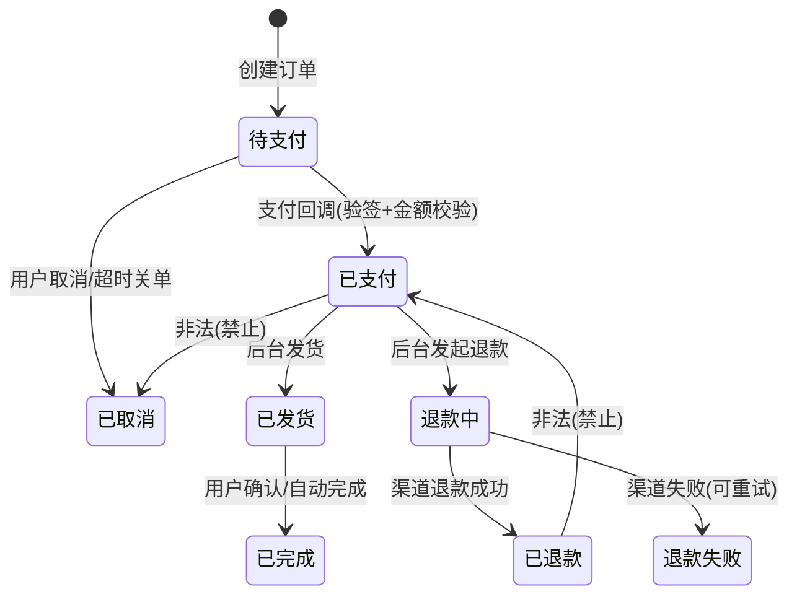

# 阶段四：功能完整性、业务闭环与数据一致性

目标：回答"这个系统能不能跑通完整业务"，而不是"接口能不能返回 200"。必须基于代码事实，不做需求脑补。

## 1. 功能矩阵

```markdown
| 功能 | 小程序 | 后端 API | 管理后台 | 闭环 | 状态 | 缺陷/建议 |
|---|---|---|---|---|---|---|
| 商品浏览 | 列表/详情/搜索 | GET /api/products, /api/products/:id | 商品管理 CRUD | 完整 | 已实现完整 | — |
| 下单支付 | 确认页→支付 | POST /api/orders, /pay/notify | 订单列表/发货 | 断在退款 | 有缺陷 | 无退款入口 |
```

状态取值只允许：**已实现完整 / 已实现有缺陷 / 部分实现 / 未发现实现 / 不适用 / 待业务确认**。
"待业务确认"单列一张表，写清"缺什么信息、向谁确认、确认后影响哪条结论"。

## 2. API 边界测试设计

每个写接口至少覆盖：

| 类别 | 输入示例 | 预期 |
|---|---|---|
| 正常 | 合法完整参数 | 2xx + 数据落库 |
| 缺必填 | 去掉 `skuId` | 400 且错误码明确，不落库 |
| 类型错 | `skuId: "abc"` | 400，不 500 |
| 空值 | `null` / `""` / `[]` | 400 或明确默认值，不写入非法状态 |
| 超长 | 255+ 字符、10MB body | 400/413，不截断入库 |
| 边界 | 0、-1、最大整数、金额 0.001 | 拒绝非法，不产生 0 元订单 |
| 重复请求 | 同参数连发 2 次 | 幂等或明确拒绝，不产生重复记录 |
| 错误 Method | GET 打 POST 接口 | 405 |
| 非法状态 | 已支付订单再支付/取消 | 4xx + 状态不变 |
| 不存在 | 不存在的 id | 404，不泄露内部信息 |
| 无权限 | 他人资源 / 无 token | 401/403，不返回数据 |
| 第三方异常 | Mock 微信/短信超时 | 事务回滚或补偿，不半成功 |
| DB 异常 | 断连/唯一冲突 | 500 且不吞异常，记录日志 |

结果表：`ID | 接口 | 用例 | 预期 | 实际 | 判定 | 证据`。

## 3. 状态机（推荐 Mermaid）



列出**非法迁移表**与"当前代码是否拦截"，这是并发缺陷的根源：

| 非法迁移 | 代码是否拦截 | 证据 |
|---|---|---|
| 已取消 → 已支付（用户取消与回调并发） | 未拦截（`UPDATE` 无状态条件） | order.service.ts:210 |

## 4. 闭环断点清单（逐条过一遍）

- 小程序有操作，后台无管理入口（用户提交后无人处理）
- 后台改了数据，小程序不刷新/缓存不失效（改了价格前端仍显示旧价）
- 状态流转缺终态（永远卡在"处理中"）
- 异常订单无人工处理入口（支付成功但未发货、退款失败）
- 重复提交产生重复记录
- 前端显示成功但服务端写失败（吞异常、事务提交失败仍返回 200）
- 服务端成功但前端超时 → 用户重试 → 重复数据
- 操作失败无恢复机制（无重试、无补偿、无人工入口）
- 后台统计与真实业务数据不一致（口径不同、缓存、软删除未过滤）
- 权限失衡：后台能做的事小程序不能看，或反之（数据对不上）

每条断点写：触发路径 + 代码位置 + 影响用户 + 建议（补入口/补状态/加幂等/加补偿）。

## 5. 数据管理完整性

### 检查项

- CRUD 是否对称（有创建无删除？有列表无详情？）
- 列表与详情字段是否一致（列表有 `status` 详情无）
- 删除是否处理关联（级联、置空、孤儿记录）
- 唯一约束是否覆盖业务唯一（`out_trade_no`、`user_id+sku_id` 限购、手机号）
- 事务边界是否覆盖多表写
- 逻辑删除的记录是否仍被关联查询/统计使用
- 误删除是否有恢复需求（软删 + 回收站 + 审计）
- 关键操作是否有审计（谁、何时、改了什么、旧值新值）

### 只读核查 SQL（按数据库方言调整）

```sql
-- 孤儿记录
SELECT o.id FROM orders o LEFT JOIN users u ON u.id = o.user_id WHERE u.id IS NULL LIMIT 20;
-- 重复业务键
SELECT out_trade_no, COUNT(*) c FROM payments GROUP BY out_trade_no HAVING c > 1 LIMIT 20;
-- 状态与时间戳矛盾
SELECT id, status, paid_at, refunded_at FROM orders WHERE status='REFUNDED' AND refunded_at IS NULL LIMIT 20;
-- 金额异常
SELECT id, total_amount, paid_amount FROM orders WHERE paid_amount < 0 OR total_amount < 0 LIMIT 20;
-- 软删除泄漏
SELECT COUNT(*) FROM products WHERE deleted_at IS NOT NULL AND status='ON_SALE';
```

只在只读账号或隔离库执行；生产库仅允许单表 `LIMIT` 抽样，禁止全表扫描式统计。

## 6. 完成判据

- [ ] 功能矩阵覆盖小程序与后台全部主要页面/入口
- [ ] 每个写接口有边界用例设计（执行与否标注清楚）
- [ ] 状态机含非法迁移与拦截证据
- [ ] 闭环断点至少覆盖支付、退款、订单履约三条主线
- [ ] 数据完整性有具体 SQL 与结果（或标注未执行原因）
- [ ] "待业务确认"已单列
