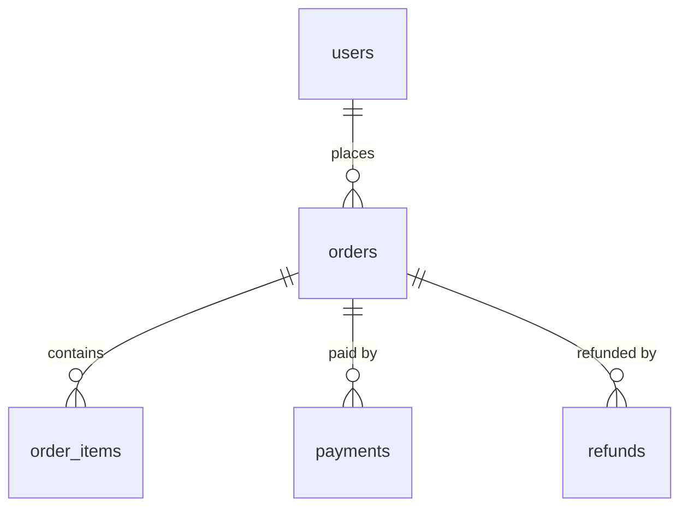

# 阶段六：最终报告模板与判级标准

报告面向"要不要上线"的决策者，先给结论，再给证据，最后给路线。所有数字要么有实测来源，要么写"未测试"。

## 结构（十节）

### 1. 项目概况
技术栈与版本、模块、接口数量、表数量、**实际分析范围**（哪些读了、哪些没读、抽样比例）、审计时间、证据类别统计。

### 2. 安全报告

```markdown
| 级别 | 模块/API | 问题 | 证据 | 触发方式 | 影响 | 修复建议 |
|---|---|---|---|---|---|---|
| P0 | POST /api/pay/notify | 通知未验签，可直接伪造已支付 | pay.ts:88-121 无 verify；[代码] | 构造 notify 报文 POST | 零元购 | 接入 APIv3 验签+解密+金额校验 |
```

必须出现的小节（无则写"未发现"）：SQL 注入、越权（BOLA/IDOR/功能级）、支付金额篡改、回调验签、重复支付/重复履约、退款越权、敏感信息泄露、限流与防爆破。

### 3. 性能报告

```markdown
| API | P50 | P95 | P99 | RPS | 错误率 | 瓶颈 | 建议 |
|---|---|---|---|---|---|---|---|
| GET /api/products | 未测试 | 未测试 | 未测试 | 未测试 | 未测试 | 疑似 N+1 + 无索引 | 见 SQL-03 |
```

未实测必须写"未测试"，禁止填估算值。附"静态性能风险清单"：N+1、缺索引、大分页、长事务、同步阻塞。

### 4. 并发与同步报告

```markdown
| 场景 | 潜在问题 | 触发条件 | 一致性影响 | 验证结果 | 方案 |
|---|---|---|---|---|---|
| 并发支付通知 | 重复发券 | 同单多次回调 | 用户多得权益 | 待验证（需隔离环境） | 幂等表 + 状态 CAS |
```

含三段延迟说明：落库延迟 / 缓存传播 / 页面可见。

### 5. 数据库审计
ER 图（Mermaid）、关联完整性问题（缺外键、孤儿、多态引用无约束）、索引与 SQL 风险、事务与并发、一致性结论、推荐改造（按成本排序）。



### 6. 功能完整性

```markdown
| 功能 | 小程序 | 后端 API | 管理后台 | 闭环情况 | 缺陷及建议 |
```

状态分布统计 + 闭环断点 Top 项。

### 7. 优先级定义

| 级别 | 判据 |
|---|---|
| P0 | 可直接造成资金损失、越权访问他人数据、数据泄露、数据损坏；或支付链路可被绕过 |
| P1 | 核心业务功能错误、重要数据一致性缺陷、明显性能瓶颈影响主流程 |
| P2 | 一般业务缺陷、架构/DB 优化、非主流程安全加固 |
| P3 | 体验优化、规范问题、低风险改进 |

### 8. 最值得优先修复的 10 项（固定格式）

```markdown
### 1. 支付通知未验签（P0）
- 文件：src/controller/pay.ts:88-121
- 业务影响：可伪造已支付，零元购
- 证据：[代码] 通知处理全文无验签调用；对照 APIv3 文档缺 Wechatpay-Signature 校验
- 触发：POST /api/pay/notify，body 中 trade_state=SUCCESS
- 修复设计：验签→解密→校验 mchid/appid/out_trade_no/amount→CAS 更新→异步入队履约
- 成本：1–2 人日
- 回归风险：回调失败导致订单不更新，需保留查单补偿
- 验收：伪造报文被拒且日志告警；真实沙箱回调可正常履约；重复回调只履约一次
```

### 9. 优化路线
- 必须立即处理（安全阻断项，上线前）
- 高收益性能与并发（唯一约束、索引、幂等、异步化）
- 数据库与事务改造（外键/约束、状态机 CAS、对账表）
- 功能补全（缺入口、缺状态、缺补偿）
- **不建议现在做**（过度设计：分库分表、微服务拆分、引入 MQ 替代事务——若当前量级不需要，明确写"不做"及理由）

### 10. 最终结论
逐条回答：
- 是否存在阻碍发布的安全问题（列出 P0 清单）
- 性能是否满足已定义目标（未定义则写"目标未定义，无法判定"）
- 并发与一致性是否可靠（哪些场景未验证）
- 小程序与后台是否闭环（断点清单）
- 结论：**建议上线 / 有条件上线 / 不建议上线**，附条件与未验证风险。

## 质量自查（交付前逐条打勾）

- [ ] 没有编造数字：所有性能/行数/覆盖率有来源或写"未测试"
- [ ] 每条结论有 ①/②/③ 标签
- [ ] 引用行号已重新核对
- [ ] 不存在"建议加索引"却无 EXPLAIN/数据量
- [ ] 不存在"疑似漏洞"被写成"已确认漏洞"
- [ ] 敏感信息已掩码
- [ ] 报告写明范围边界与未覆盖模块
- [ ] Top10 每项都有 file:line 与验收标准
- [ ] "不建议现在做"一节存在（防止过度设计）
- [ ] 结论与证据一致，无自相矛盾

## 写作风格

- 结论先行：每节开头一句话说结论，表格给细节。
- 使用"事实—影响—动作"三段式描述缺陷。
- 不写"建议加强安全意识"这类无法执行的话；写具体改哪个函数、加什么约束、如何验收。
- 保留不确定性：无法判定的写"需业务确认"，不要用模糊词掩盖。
